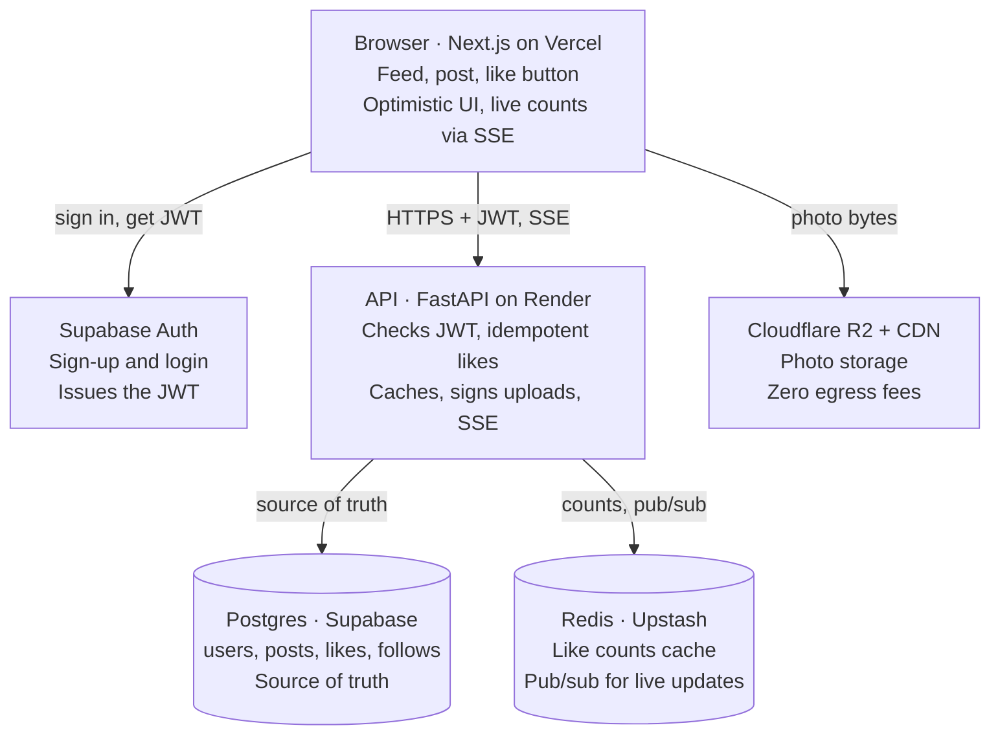

# Mini-Instagram: System Design & Build Plan

> Design doc for this repo. Claude Code: read this file before making changes. It is the source of truth for architecture, schema, and build order.
>
> Live version (editable): https://claude.ai/code/artifact/592e3eb1-9f15-4753-a96e-baf540884036 · Exported Oct 13, 2026

Build a small Instagram-style app on a $0 stack, using the same building blocks a real social network uses: a web client, a stateless API, Postgres as the source of truth, Redis as a cache, object storage plus CDN for images, and a real-time channel for live counts.

## Goal and scope

The demo proves one end-to-end story with three people:

1. **User A** signs up and posts a photo with a caption.
2. **User B** sees it in their feed and taps like. Tapping twice must never count twice.
3. **User C** opens the post and sees the correct like count, and it updates live if someone else likes it while C is watching.

**In scope:** sign-up and login, create post (image + caption), home feed, like and unlike, like count, "you liked this" state, follow, live count updates.

**Out of scope for v1:** comments, stories, DMs, search, notifications, video, moderation. Each one reuses the same blocks, so they are easy add-ons later.

**Design principle:** keep the app small but keep the architecture real. Every component below exists for a reason you would defend in a system design interview, not because a tutorial used it.

## Architecture



Photos travel straight from the browser to R2; every like goes through the API, which writes Postgres first and then updates Redis and pushes the new count to viewers.

## Building blocks and free stack

Every block below has a free tier that comfortably covers a demo; the only real trade-offs are cold starts and auto-pausing when the app sits idle.

| Building block | Why a real network needs it | Demo choice ($0) | Free-tier limits to know |
| --- | --- | --- | --- |
| Web client | Renders feed, post, like button | Next.js (React) on Vercel Hobby | Plenty for a demo |
| API server | Stateless business logic, auth checks, idempotent writes | Python FastAPI on [Render](https://temps.sh/blog/render-pricing-2026) free web service | 512 MB, spins down after 15 min idle, ~1 min to wake; 750 instance hours/month |
| Primary database | Source of truth: users, posts, likes, follows | Postgres on [Supabase](https://www.activepieces.com/blog/supabase-pricing-free-tier-limits-pro-costs-egress) | 500 MB DB, 5 GB egress, 2 projects; pauses after 1 week inactive |
| Auth | Who is calling; issues JWTs | Supabase Auth | 50,000 monthly active users |
| Cache + counters | Fast reads of hot posts and like counts | [Upstash Redis](https://www.srvrlss.io/provider/upstash/) | 256 MB, 500K commands/month, no card needed |
| Object storage + CDN | Photos never go in the DB | [Cloudflare R2](https://www.spendbase.co/?p=35561) | 10 GB storage, 1M writes + 10M reads/month, zero egress fees |
| Real-time channel | Push live like counts to viewers | Server-Sent Events from the API, fed by Redis pub/sub | Uses the same Redis quota |
| Background jobs | Counter reconciliation, thumbnails, fan-out | Upstash QStash, or a cron job | 1,000 messages/day free |
| Local dev | Run everything offline | Docker Compose with Postgres + Redis | Free |

**Why a separate API server instead of letting the browser talk to Supabase directly?** You could, and many hobby apps do. But a real network puts a stateless API tier in the middle so it can enforce rules (one like per user), shape responses, cache, and scale horizontally. That tier is the part you most want to learn.

**Cold-start workaround:** before a demo, hit the API once to wake it, or upgrade only the API to Render's $7/month instance on the day you present.

## Data model

Four tables carry the whole demo; the `likes` table is the source of truth, and `posts.like_count` is a denormalized copy so nobody has to run `COUNT(*)` on every page view.

```sql
CREATE TABLE users (
  id           uuid PRIMARY KEY,          -- same id as Supabase Auth
  username     text UNIQUE NOT NULL,
  display_name text,
  avatar_key   text,                      -- R2 object key, not the image
  created_at   timestamptz DEFAULT now()
);

CREATE TABLE posts (
  id          bigint GENERATED ALWAYS AS IDENTITY PRIMARY KEY,
  author_id   uuid NOT NULL REFERENCES users(id),
  caption     text,
  image_key   text NOT NULL,              -- e.g. posts/2026/10/abc.jpg in R2
  like_count  integer NOT NULL DEFAULT 0, -- denormalized counter
  created_at  timestamptz DEFAULT now()
);
CREATE INDEX posts_author_time ON posts (author_id, created_at DESC);

CREATE TABLE likes (
  post_id    bigint REFERENCES posts(id) ON DELETE CASCADE,
  user_id    uuid   REFERENCES users(id),
  created_at timestamptz DEFAULT now(),
  PRIMARY KEY (post_id, user_id)          -- one like per user per post
);
CREATE INDEX likes_user ON likes (user_id, created_at DESC);

CREATE TABLE follows (
  follower_id uuid REFERENCES users(id),
  followee_id uuid REFERENCES users(id),
  created_at  timestamptz DEFAULT now(),
  PRIMARY KEY (follower_id, followee_id)
);
CREATE INDEX follows_followee ON follows (followee_id);
```

Three design choices worth noticing:

- **The composite primary key on `likes` is the idempotency guarantee.** The database itself refuses a second like from the same user, so a double-tap or a retried request can never inflate the count.
- **Images live in object storage; the DB stores only the key.** Databases are bad at serving large binaries and Supabase's free DB is 500 MB.
- **Indexes match the queries.** `(author_id, created_at DESC)` serves "latest posts by people I follow"; `(user_id, created_at)` serves "which of these posts did I like".

## The like flow, end to end

A like is one Postgres transaction that is idempotent by design, followed by a cache update and a broadcast; the third viewer reads the count from Redis and falls back to Postgres on a miss.

### Write path: User B taps like

1. Browser sends `POST /posts/42/like` with B's JWT. The button flips to liked immediately (optimistic UI) and rolls back if the call fails.
2. API verifies the JWT and extracts `user_id`. It never trusts a user id sent in the request body.
3. API runs one transaction:

```sql
WITH ins AS (
  INSERT INTO likes (post_id, user_id) VALUES ($1, $2)
  ON CONFLICT DO NOTHING
  RETURNING 1
)
UPDATE posts SET like_count = like_count + 1
WHERE id = $1 AND EXISTS (SELECT 1 FROM ins)
RETURNING like_count;
```

4. If no row came back, B had already liked it: return the current count, change nothing. That is idempotency.
5. API writes the new count to Redis (`SET post:42:likes 18`) so readers see it at once.
6. API publishes `{post:42, likes:18}` on Redis channel `post-events`.
7. API returns `{liked: true, like_count: 18}`.

Unlike is the mirror image: `DELETE ... RETURNING`, then decrement only if a row was deleted.

### Read path: User C opens the post

1. `GET /posts/42` (or the feed) with C's JWT.
2. **Cache-aside:** API asks Redis for `post:42:likes`. Hit: use it. Miss: read Postgres, then store it in Redis with a TTL of a few minutes.
3. API checks whether C liked it: `SELECT post_id FROM likes WHERE user_id = $c AND post_id = ANY($ids)` — one query for the whole feed page, never one per post.
4. Response: post, image URL from the CDN, `like_count`, `viewer_has_liked`.
5. C's browser holds an SSE connection to `/stream`. When step 6 of the write path fires, the API pushes the new count and C's screen updates without a refresh.

### Why this is correct, and where it bends

- **The truth is the `likes` table.** The counter and the cache are copies. A nightly job can recompute `SELECT post_id, COUNT(*) FROM likes GROUP BY post_id` and fix any drift.
- **Counts are allowed to be slightly stale.** Every real network accepts this: a viewer seeing 17 for a second before 18 is fine; a user's own like disappearing is not.
- **The hot-post problem.** If thousands like one post at once, every transaction queues on the same `posts` row lock. Real systems then stop incrementing the row directly: they `INCR` in Redis and flush to Postgres in batches every few seconds, or split the counter into shards that are summed on read. Build the simple version first, then load-test it to watch it bend.

## Feed, uploads, real-time and auth

The demo uses the simplest correct version of each, and each has a named upgrade path you can build later to learn the trade-off.

### Home feed

- **Demo: fan-out on read.** When B opens the app, query the latest posts from people B follows: `SELECT ... FROM posts WHERE author_id IN (SELECT followee_id FROM follows WHERE follower_id = $b) ORDER BY created_at DESC LIMIT 20`.
- **Pagination by cursor, not offset:** pass the last `created_at, id` seen and fetch rows older than it. Offsets get slow and skip posts when new ones arrive.
- **Upgrade: fan-out on write.** When A posts, push the post id into a Redis list per follower (`feed:{user}`). Reads become one Redis call. The catch is the celebrity with millions of followers, which is why big networks mix both approaches.

### Photo upload

1. Client asks the API for an upload slot: `POST /uploads`.
2. API returns a **presigned R2 URL** valid for a few minutes.
3. Browser uploads the file straight to R2. The image bytes never pass through your API server.
4. Client calls `POST /posts` with the object key and caption.
5. Viewers load the image from R2's public URL behind Cloudflare's CDN.
6. Optional job: generate a thumbnail asynchronously.

### Real-time like counts

- **Demo:** Server-Sent Events. Each API instance subscribes to Redis `post-events` and forwards updates to the browsers connected to it. Redis pub/sub is what lets this work across several API instances.
- **Simpler fallback:** poll `GET /posts/42/likes` every 5 seconds. Good enough to start.
- Watch the Upstash quota: pub/sub and polling both spend Redis commands.

### Authentication

- Supabase Auth handles sign-up, login and password reset, and issues a JWT.
- The browser sends the JWT on every API call; FastAPI verifies its signature with the project's JWT secret and reads the user id from it.
- Rule of thumb: the API decides who the user is from the token, never from the request body.

## Demo vs. a network at real scale

The shapes are the same; what changes at scale is how many copies of each box exist and how data is split across them.

| Concern | This demo | At large scale |
| --- | --- | --- |
| API tier | 1 instance, sleeps when idle | Many stateless instances behind a load balancer, autoscaled |
| Database | One Postgres | Sharded by user or post id, read replicas, some data in wide-column stores |
| Like counter | Row increment in a transaction | Buffered in Redis, flushed in batches, or sharded counters |
| Cache | One Redis, cache-aside | Large cache clusters in front of every hot read |
| Feed | Built at read time | Precomputed per user, hybrid for celebrities |
| Media | R2 + Cloudflare CDN | Multi-region object storage + global CDN, many image sizes |
| Async work | Optional cron | Message queues and event streams (Kafka-style) for every side effect |
| Consistency | Strong for your own like, eventual for counts | Same contract, enforced across regions |

Concepts this demo lets you see for real: idempotent writes, denormalized counters, cache-aside and invalidation, eventual consistency, pub/sub, presigned uploads, cursor pagination, and fan-out on read vs write.

## Build plan

Build locally first, deploy once the like flow works, then add the scale features one at a time so you can see each one change the system.

1. **Phase 0 — Local skeleton.** Docker Compose with Postgres + Redis, FastAPI app, Next.js app, schema migrations, seed script with 3 users (A, B, C).
2. **Phase 1 — Auth and posts.** Supabase Auth, JWT check in FastAPI, presigned R2 upload, create post, user profile grid.
3. **Phase 2 — Likes (the core).** Idempotent like and unlike, `like_count`, `viewer_has_liked`, optimistic UI. Test: double-click, two browsers, retry.
4. **Phase 3 — Follow and feed.** Follow and unfollow, home feed with cursor pagination.
5. **Phase 4 — Cache and real-time.** Redis cache-aside for counts, pub/sub, SSE stream; C sees B's like appear live.
6. **Phase 5 — Deploy for $0.** Vercel, Render, Supabase, Upstash, R2. Environment variables, CORS, a health check.
7. **Phase 6 — Make it bend.** Load-test one hot post with k6, watch lock contention, then switch to the Redis-buffered counter plus a reconciliation job and compare.

### Decisions before we start coding

- API language: Python FastAPI (recommended) or Node/TypeScript? — **decision: Python FastAPI.** Instagram's own backend is Python (Django), so this matches the real thing.
- Photos from day one, or text posts first and images in Phase 1? — **decision: images in Phase 1.** Phase 0 seeds posts with placeholder image keys and the web shows a placeholder tile; presigned R2 uploads arrive in Phase 1.
- One repo (monorepo with `web/` and `api/`) or two? — **decision: monorepo** with `web/` and `api/` and one shared `docker-compose.yml`.
